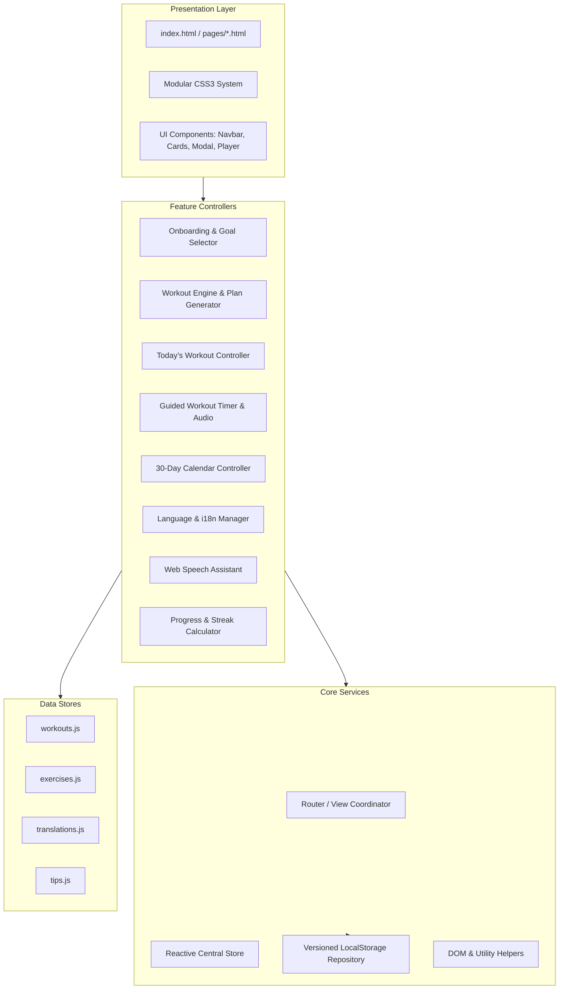
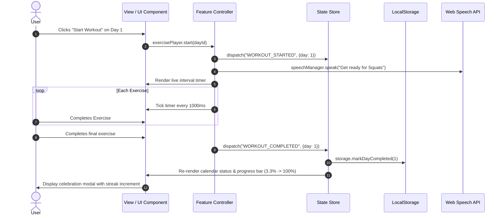

# FitLife: System Architecture & Data Flow

**Document Version:** 1.0.0  
**Architectural Model:** Modular Vanilla JavaScript (ES6+ Modules) Single Page / Multi-View Architecture  

---

## 1. High-Level Architecture Overview

FitLife utilizes a client-side, zero-dependency, event-driven architecture designed to run reliably in any modern web browser without server compilation, bundlers, or heavy virtual DOM abstractions.



---

## 2. Module Responsibilities

### 2.1 Core Services (`js/core/`)
- **`router.js`**: Handles client-side view switching (`#home`, `#plan`, `#workout`, `#tips`, `#profile`) as well as multi-page transitions while preserving shared application state.
- **`state.js`**: A lightweight reactive state container with subscriber listeners (`subscribe(event, callback)`, `dispatch(event, payload)`). Ensures components re-render immediately when state changes (e.g., language switched, workout completed).
- **`storage.js`**: Abstraction layer over browser `localStorage` providing schema versioning (`FITLIFE_V1`), automatic JSON parsing/stringifying, quota error recovery, and in-memory fallback for private browsing.
- **`helpers.js`**: Pure utility functions: format seconds to `MM:SS`, sanitize DOM strings, generate safe IDs, manage debounced handlers.

### 2.2 Feature Controllers (`js/features/`)
- **`workout-engine.js`**: Generates and personalizes the 30-day program based on the user's fitness goal, experience level, and target duration. Validates every day's sequence, warm-ups, workouts, rest intervals, and cool-downs.
- **`daily-workout.js`**: Resolves which day is active today, fetches corresponding exercise definitions, and binds them to the main workout dashboard.
- **`exercise-player.js`**: Drives the live guided workout session: executes interval countdown timers, triggers acoustic chimes, calls the speech synthesis coach, handles pause/resume/skip, and completes sessions.
- **`workout-calendar.js`**: Renders the 30-day interactive plan grid, computes status badges (Done, Today, Start, Relax), and binds modal or view openers.
- **`language-manager.js`**: Injects localized strings throughout the DOM by scanning elements with `data-i18n` attributes, updates HTML `lang` attributes, and broadcasts language change events.
- **`speech-manager.js`**: Interfaces with the browser `window.speechSynthesis` API, resolves language-specific voice sets (`en-US`, `hi-IN`, `gu-IN`), handles playback/pause/cancel, and manages fallbacks.
- **`progress-tracker.js`**: Calculates active streaks, completed sessions count, total workout minutes, and overall plan progress percentage `(completedDays / 30) * 100`.

### 2.3 Data Repositories (`js/data/`)
- **`exercises.js`**: Master catalog of all exercise definitions: ID, English/Hindi/Gujarati names, step instructions, primary/secondary muscles, form tips, safety warnings, and media references.
- **`workouts.js`**: Canonical 30-day curriculum with daily objectives, target rest times, and category tags.
- **`translations.js`**: Central trilingual dictionary for all UI text, error alerts, navigation items, and button labels.
- **`tips.js`**: Curated library of evidence-based fitness, sleep, hydration, and nutrition tips.

---

## 3. Data Flow & State Lifecycle



---

## 4. Storage Architecture & Schema

FitLife stores state under isolated keys to ensure resilience:

```json
{
  "_version": 1,
  "profile": {
    "goal": "weight_loss",
    "level": "beginner",
    "duration": 15,
    "language": "en",
    "soundEnabled": true,
    "speechSpeed": 1.0,
    "onboardingComplete": true,
    "createdAt": "2026-11-20T11:00:00.000Z"
  },
  "progress": {
    "currentDay": 1,
    "completedDays": [1],
    "streak": 1,
    "lastCompletedDate": "2026-11-20",
    "totalMinutes": 15,
    "history": [
      {
        "day": 1,
        "completedAt": "2026-11-20T11:15:00.000Z",
        "duration": 15,
        "exerciseCount": 4
      }
    ]
  }
}
```

---

## 5. Media & Fallback Architecture

To ensure 100% reliability regardless of network conditions or missing remote media:
1. **Adaptive Asset Resolution:** The player checks whether local video exists. If missing, it renders a high-definition HTML5 `<canvas>` animation illustrating the exercise movement trajectory or displays the verified step demonstration photo series.
2. **Accessible SVG Icons:** All icons are encoded as lightweight inline SVGs with appropriate ARIA roles, eliminating external font dependencies.
3. **Lazy-loading:** All thumbnail images specify `loading="lazy"` and decoding attributes to preserve bandwidth and battery life on mobile devices.
