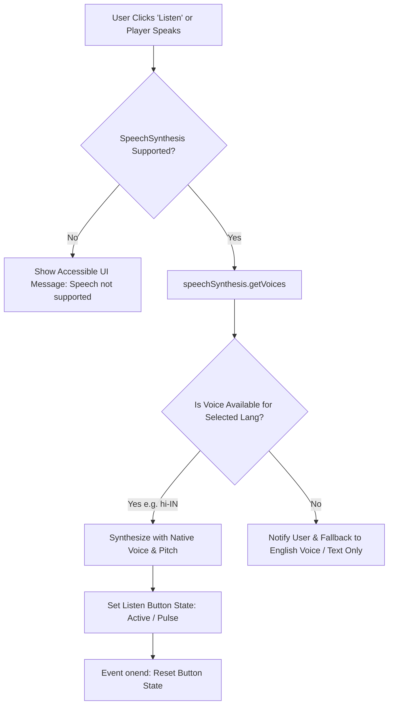

# FitLife: Audio Architecture & Speech Accessibility

**Document Version:** 1.0.0  

---

## 1. Web Speech Synthesis Strategy

FitLife features a built-in voice fitness coach that reads exercise names, step instructions, and countdown alerts directly to the user in their preferred language.

We utilize the standard browser **Web Speech API (`window.speechSynthesis`)**:
- Zero network bandwidth needed (utilizes operating system built-in voice synthesizers).
- Extremely low latency (< 50ms startup).
- Works offline on iOS, Android, macOS, Windows, and ChromeOS.

---

## 2. Voice Selection & Fallback Logic

Operating systems vary in the voices they install. The `SpeechManager` (`js/features/speech-manager.js`) resolves voices dynamically:

### Voice Matching Priorities:
1. **Hindi (`hi`)**: Looks for voices with `lang` matching `hi-IN` or containing "Hindi".
2. **Gujarati (`gu`)**: Looks for voices with `lang` matching `gu-IN` or containing "Gujarati".
3. **English (`en`)**: Looks for voices with `lang` matching `en-IN`, `en-US`, or `en-GB`.

---

## 3. Audio Controls & UX Rules

1. **User-Initiated Playback**: In compliance with browser autoplay security policies, audio speech never triggers unexpectedly upon page load. The user must click **"🔊 Listen"** or explicitly click **"Start Workout"**.
2. **Prevent Overlapping Audio**: Before invoking `speechSynthesis.speak()`, the manager always invokes `speechSynthesis.cancel()` to cleanly terminate any previous voice queue.
3. **Speed & Volume Tuning**:
   - Default speech rate: `1.0`
   - Senior / slow preference: `0.85`
   - Volume: `1.0`
   - Configurable in Profile Settings.
4. **Accessible Feedback**:
   - When speaking, the button icon animates and displays "⏹ Stop".
   - Clicking again invokes `speechSynthesis.cancel()` and returns to "🔊 Listen".

---

## 4. Acoustic Audio Feedback (Web Audio API)

In addition to voice synthesis, the guided workout timer generates pleasant, synthetic acoustic chimes using the browser `AudioContext`:
- **Interval Warning (3, 2, 1 seconds remaining):** Short 440Hz sine chime (80ms).
- **Interval Transition (Go / Work):** Bright double-tone chime (587Hz -> 880Hz).
- **Rest Interval:** Warm descending chime (659Hz -> 523Hz).
- **Sound Toggle:** Can be muted at any time from the player header or profile settings.
