# FitLife: Phased Implementation Roadmap

**Document Version:** 1.0.0  

---

## Roadmap Phases Overview

```mermaid
flowchart LR
    P1[Phase 1: Analysis] --> P2[Phase 2: Docs]
    P2 --> P3[Phase 3: Validation Gate]
    P3 --> P4[Phase 4: Folder Structure]
    P4 --> P5[Phase 5: CSS & Design Tokens]
    P5 --> P6[Phase 6: Home & Nav]
    P6 --> P7[Phase 7: Onboarding]
    P7 --> P8[Phase 8: Workout Engine]
    P8 --> P9[Phase 9: Daily & Calendar]
    P9 --> P10[Phase 10: Player & Timers]
    P10 --> P11[Phase 11: Media & Fallbacks]
    P11 --> P12[Phase 12: Multilingual]
    P12 --> P13[Phase 13: Web Speech API]
    P13 --> P14[Phase 14: Progress Tracking]
    P14 --> P15[Phase 15: Tips & Lifestyle]
    P15 --> P16[Phase 16: Testing]
    P16 --> P17[Phase 17: Bug Fixes]
    P17 --> P18[Phase 18: Final Audit]
```

---

## Detailed Phase Breakdown

### Phase 1: Project Analysis & Asset Audit
- **Objective:** Evaluate repository state, existing files, inspect reference graphics.
- **Status:** COMPLETED.

### Phase 2: Create All Markdown Documentation
- **Objective:** Create complete technical and design documentation suite.
- **Files:** `README.md`, `docs/*.md` (19 documents).
- **Status:** COMPLETED.

### Phase 3: Documentation Validation Gate & Review
- **Objective:** Verify absence of contradictions, validate architecture, generate `docs/DOCUMENTATION_REVIEW.md`.
- **Status:** PENDING.

### Phase 4: Create Project Folder Structure
- **Objective:** Establish canonical `css/`, `js/`, `assets/`, `pages/`, `tests/` directories.
- **Status:** PENDING.

### Phase 5: Implement Design Tokens, Global CSS & Reusable Components
- **Objective:** Implement `variables.css`, `reset.css`, `typography.css`, `components.css`, `layout.css`, buttons, cards, badges.
- **Status:** PENDING.

### Phase 6: Implement Home Page & Navigation
- **Objective:** Implement desktop header, mobile bottom navigation, hero section, benefit cards, teaser previews matching the reference image.
- **Status:** PENDING.

### Phase 7: Implement Onboarding & Personalization
- **Objective:** 4-step interactive wizard for goals, level, duration, language; save to `localStorage`.
- **Status:** PENDING.

### Phase 8: Implement Workout Data & 30-Day Engine
- **Objective:** Author comprehensive `exercises.js` and `workouts.js` covering Days 1 to 30.
- **Status:** PENDING.

### Phase 9: Implement Today's Workout & 30-Day Calendar Grid
- **Objective:** Daily workout presenter and interactive 30-day card calendar with status indicators.
- **Status:** PENDING.

### Phase 10: Implement Exercise Details & Guided Workout Player
- **Objective:** Full-screen interval player with active/rest timers, pause/resume, skip, finish modal.
- **Status:** PENDING.

### Phase 11: Implement Images, Videos & Fallbacks
- **Objective:** High-resolution assets, animated canvas demo fallback, lazy loading.
- **Status:** PENDING.

### Phase 12: Implement Multilingual Support (English, Hindi, Gujarati)
- **Objective:** Instant client-side switching, natural localized exercise instructions, regional fonts.
- **Status:** PENDING.

### Phase 13: Implement Voice Assistant (Web Speech API)
- **Objective:** "🔊 Listen" button reading exercise instructions in selected language with speech rate options.
- **Status:** PENDING.

### Phase 14: Implement Progress Tracking & Profile Settings
- **Objective:** Streak calculation, percentage completion meter, history logs, reset progress modal.
- **Status:** PENDING.

### Phase 15: Implement Fitness Tips & Wellness Education
- **Objective:** Hydration, nutrition, sleep, and recovery guidance cards.
- **Status:** PENDING.

### Phase 16: Automated, Accessibility & Viewport Testing
- **Objective:** Execute Node.js test suite, verify 320px–1440px layouts, check WCAG 2.1 AA compliance.
- **Status:** PENDING.

### Phase 17: Bug Fixing & Refinement
- **Objective:** Polish styling, resolve edge cases, ensure zero console errors.
- **Status:** PENDING.

### Phase 18: Final Delivery & Documentation Updates
- **Objective:** Update `CHANGELOG.md`, `KNOWN_ISSUES.md`, create `docs/FINAL_IMPLEMENTATION_REPORT.md`.
- **Status:** PENDING.
